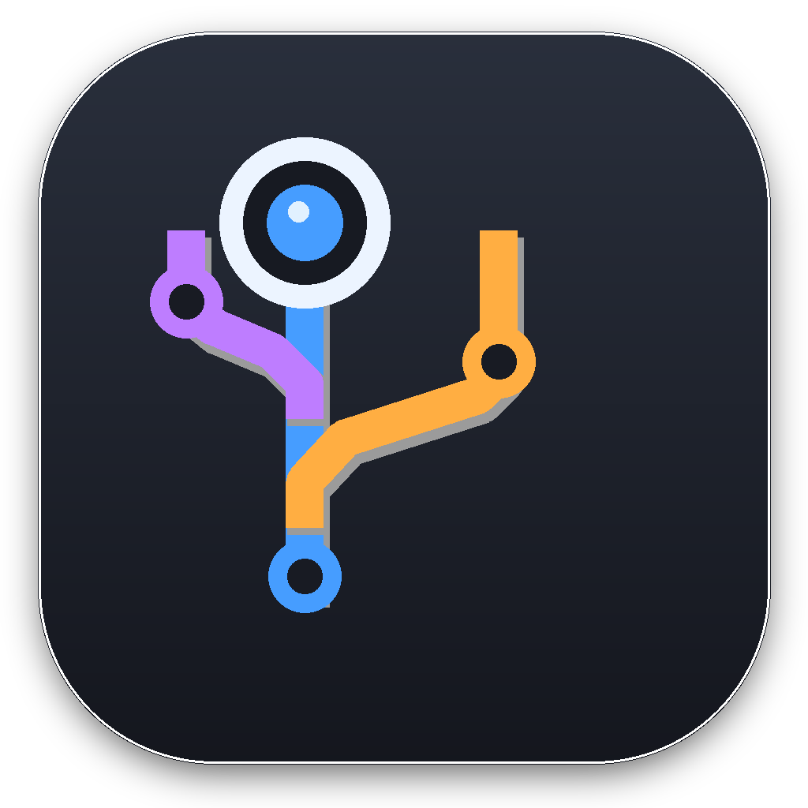

<p align="center">
  
</p>

<h1 align="center">git-sight</h1>

<p align="center">
  See the work your agents left behind, in every repository at once.<br>
  A native macOS app. Read-only by design.
</p>

Run a few coding agents for a week and your disk fills with branches nobody pushed, stashes nobody remembers, worktrees an agent created and walked away from. git does not tell you any of this unless you go into each repository and ask.

git-sight asks for you. Point it at the folder with your repositories and it shows, on one screen, whether there is unfinished work, where it is, and how long it has been sitting there.

## What it finds

| | |
| --- | --- |
| **Uncommitted files** | in any worktree, dated by the newest change |
| **Unpushed commits** | on local branches, against every remote, not just the upstream |
| **Orphaned commits** | on a detached HEAD that no branch, tag or remote holds |
| **Stashes** | pinned by hash, so stashing again does not shuffle them |
| **Unmerged branches** | pushed, but never made it into the default branch; squash merges count as merged |
| **Leftovers** | merged branches and the agent worktrees still holding them |

Work that exists only on this machine gets a verdict by age: **In progress** for the first three days, **Abandoned** after that (a stash after one day), **Forgotten** after a month. A pushed branch that never got merged ages slower: two weeks in progress, abandoned after that, forgotten after two months. Leftovers lose nothing, so they are only ever **Clutter**.

Repositories are sorted by weight: size × age × risk. Size is files for uncommitted work and commits for the rest. Age grows on a log scale: a week counts almost three times as much as today, three months about six times. Work on the server counts for less than work only on this Mac, and leftovers for less still.

## One screen for all of it

- **Overview.** A row per repository and a bubble per kind of work, sized by how much there is and colored by its verdict. Click a bubble to open that work.
- **Worktrees and branches.** Each repository lists its worktrees, then branches not checked out anywhere, then stashes whose branch is gone. Every chip jumps to its spot in the graph.
- **The graph.** All branches, remote branches, tags and worktrees, drawn the way VS Code draws it. Uncommitted files and stashes get rows of their own above the commit they sit on. Commits the server lacks sit on an orange band.
- **Live.** An FSEvents watcher rereads only the repository that changed. Edits, commits and stashes show up within a second, and repositories touched in the last 15 minutes move up under "Live now".
- **Files and diffs.** Click a row in the graph and its files open under it. Click a file and its diff opens below.
- **A task for your agent.** One button copies a self-contained request: what was found, where, and what to do. It always asks the agent to wait for your go-ahead before deleting anything.
- **Readable.** ⌘+ and ⌘− scale all text, the graph included.

## Read-only, and it means it

Every git call runs with `--no-optional-locks`, hooks pointed at `/dev/null`, fsmonitor and signature checks off, and `GIT_*` variables stripped from the environment. Filter drivers from a repository's own config are switched off; diffs go through plumbing with `--no-ext-diff --no-textconv`, so the index is never rewritten. Squash merges are found by comparing files, not by test-merging, which would write objects. A repository's config cannot make git-sight run a program. Integration tests plant hooks, fsmonitor daemons, signing programs, filters and diff drivers, and check that none of them fire and the index stays as it was.

## Build

macOS 14 or later. Command Line Tools are enough.

```sh
sh Scripts/package_app.sh
open Artifacts/GitSight.app
```

## Develop

```sh
swift run GitSightTests                 # integration tests against real git repositories
python3 Scripts/make_demo_workspace.py  # a folder of made-up repositories, one per verdict
sh Scripts/render_window.sh window.png .build/DemoWorkspace search-api unmerged 1360 860 light
```

`swift test` needs Xcode, so the tests are a plain executable. Every test lands red first, then green with the mutants it killed named in the commit. See [CONTRIBUTING.md](CONTRIBUTING.md).

## License

MIT
